# 02 – Datenbankmodell & ER-Diagramm

Stand: 10.10.2026 · Referenz-DDL: [schema.sql](schema.sql) · Zielsystem: MySQL 8 beim Hoster (Shared Hosting), umgesetzt als Laravel-12-Migrations.

> Hinweis: Der Kommentar „Primärsuche Meilisearch“ in `schema.sql` (Index `ft_prod`) ist durch die Plattformentscheidung überholt. Auf Shared Hosting ist der **MySQL-FULLTEXT-Index die Primärsuche**; Meilisearch kommt erst in Ausbaustufe 2 (siehe [14-skalierung.md](14-skalierung.md)).

## 1. Konventionen

| Thema | Regel |
|---|---|
| Zeichensatz | `utf8mb4`, Kollation `utf8mb4_0900_ai_ci` (akzent-/groß-klein-unabhängige Suche: „Lauflänge“ = „lauflange“) |
| Primärschlüssel | `BIGINT UNSIGNED AUTO_INCREMENT`; kleine Stammdaten `SMALLINT UNSIGNED` |
| Öffentliche Kennungen | Nie die interne ID: `order_number` (AF-2026-000123), `customer_number`, `reference` (VS-/AK-…), `token`, Slugs |
| Geld | Ganzzahlig in **Cent**, brutto (B2C-Shop, Preise inkl. MwSt.); Steuersatz wird pro Position als Snapshot gespeichert |
| Zeit | UTC in der DB, Darstellung `Europe/Berlin`; Audit-Log mit Millisekunden (`TIMESTAMP(3)`) |
| Löschen | Kunden: Soft-Delete + Anonymisierung (Aufbewahrungspflichten HGB/AO/WaffG). Bestell-, Rechnungs-, Waffenbuchdaten: nie physisch löschen bis Fristende |
| Snapshots | Bestellungen speichern Adressen (JSON), Artikelname, SKU, Rechtsklasse, Preis, Steuersatz zum Bestellzeitpunkt |
| Enums | MySQL-`ENUM` für stabile Statuswerte, in PHP als Backed Enums (`App\Domain\Orders\Enums\OrderStatus`) gespiegelt |
| Fremdschlüssel | Immer mit Constraint; `ON DELETE CASCADE` nur für reine Kind-Daten (Medien, Positionen eines Warenkorbs) |

## 2. Entitäten nach Domäne

### 2.1 Identität & Sicherheit

| Tabelle | Zweck | Schlüsselfelder | Hinweise |
|---|---|---|---|
| `users` | Kunden **und** Mitarbeiter (Unterscheidung über Rollen) | `customer_number`, `customer_type` (private/company/authority/dealer), `email` (unique), `birth_date`, `age_verified_at`, `age_verification_method`, `two_factor_*`, `locked_until`, `deleted_at` | 2FA-Secret/Recovery-Codes verschlüsselt (Fortify) |
| `addresses` | Rechnungs-/Lieferadressen | `user_id`, `type`, `is_default` | Bestellungen kopieren die Adresse als JSON |
| `roles`, `permissions`, `model_has_roles`, `model_has_permissions`, `role_has_permissions` | spatie/laravel-permission | `guard_name` = `web` | Rollen siehe [07-rollen-rechte.md](07-rollen-rechte.md) |
| `sessions` | Datenbank-Sessions (Shared Hosting) | `id`, `user_id`, `last_activity` | Ermöglicht „aktive Sitzungen beenden“ im Konto |
| `personal_access_tokens` | Sanctum-Tokens für `/api/v1` | `tokenable_*`, `abilities`, `expires_at` | Ablauf max. 90 Tage |
| `audit_logs` | Revisionssicheres Protokoll | `actor_*`, `action`, `subject_*`, `old_values`, `new_values`, `prev_hash`, `hash` | Hash-Kette; DB-User der App ohne UPDATE/DELETE-Recht (wenn Hoster getrennte Grants erlaubt, sonst Prüfjob) |
| `consent_records` | Nachweis Cookie-Einwilligung | `consent_id`, `categories`, `banner_version`, `ip_hash` | Kein Klartext-IP |

### 2.2 Compliance (Erwerbsrecht)

| Tabelle | Zweck | Schlüsselfelder |
|---|---|---|
| `legal_classes` | Rechtsklasse je Produkt | `code`, `min_age`, `requires_entitlement`, `accepted_entitlements` (JSON), `shipping_mode`, `allowed_payment_codes` (JSON), `requires_serial`, `notice_text` |
| `customer_documents` | Hochgeladene Nachweise | `type`, `document_number` (verschl.) + `document_number_bidx`, `valid_until`, `storage_path` (private Disk), `sha256`, `status`, `precheck_result`, `reviewed_by`, `delete_after` |
| `customer_entitlements` | Konkrete, von Menschen angelegte Berechtigungen | `type`, `weapon_kind`, `caliber_id`, `quantity_total`, `quantity_used`, `valid_from/until`, `status`, `created_by` |
| `order_compliance_checks` | Ergebnis jeder Prüfung je Bestellung/Position | `check_type`, `entitlement_id`, `result`, `details`, `checked_by` |
| `weapon_items` | Einzelne Waffe mit Seriennummer | `serial_number` (verschl.) + `serial_bidx` (unique), `nwr_id`, `status` |
| `weapon_book_entries` | Elektronisches Waffenhandelsbuch (§ 23 WaffG) | `direction` in/out, `counterparty` (verschl. JSON), `permit_reference`, `order_id`, `nwr_reported_at`, `booked_by` | 

Stammdaten `legal_classes` (Seed):

| code | min_age | Nachweis | shipping_mode | Zahlarten | Seriennr. |
|---|---|---|---|---|---|
| `free_general` | 0 | – | standard | alle | nein |
| `free_18` | 18 | Altersnachweis | age_check | Vorkasse, Bar, Waffen-PSP | nein |
| `wbk_shortgun` | 18* | WBK-Voreintrag, rote WBK, Händler, Behörde | weapon_personal | Vorkasse, Bar, Waffen-PSP | ja |
| `wbk_longgun` | 18* | Voreintrag, gelbe WBK, Jagdschein, rote WBK, Händler, Behörde | weapon_personal | Vorkasse, Bar, Waffen-PSP | ja |
| `ammo` | 18 | Munitionserwerbsberechtigung, Jagdschein, Händler, Behörde | weapon_personal | Vorkasse, Bar, Waffen-PSP | nein |
| `essential_part` | 18 | Voreintrag, Jagdschein (z. B. Schalldämpfer), Händler, Behörde | weapon_personal | Vorkasse, Bar, Waffen-PSP | ja |
| `pickup_only` | 18 | Prüfung im Laden | pickup_only | Vorkasse, Bar | nein |

\* Die effektive Altersgrenze ergibt sich aus der **Berechtigung** (die Behörde hat Alter/MPU bereits geprüft). Zusätzlich prüft der Checkout das Mindestalter der Klasse; Sonderfälle (21/25) siehe [10-waffenrecht-compliance.md](10-waffenrecht-compliance.md).

### 2.3 Katalog

| Tabelle | Zweck | Schlüsselfelder |
|---|---|---|
| `manufacturers` | Hersteller inkl. SEO-Landingpage | `slug`, `logo_path`, `hero_media_path`, `content`, `is_featured` |
| `categories` | Baum mit materialisiertem Pfad | `parent_id`, `path` (unique, z. B. `kurzwaffen/pistolen`), `default_legal_class_id` |
| `calibers` | Kaliber inkl. Aliase | `slug`, `aliases` (JSON), `kind`, `is_large_bore` |
| `tax_rates` | 19 % / 7 % | `rate` |
| `products` | Artikel | `sku`, `slug`, `manufacturer_id`, `caliber_id`, `legal_class_id`, `product_type`, `weapon_kind`, `condition_code`, `is_unique_item`, `usage_*`, `price_gross`, `special_*`, `lowest_price_30d`, `stock_quantity`, `stock_reserved`, `availability`, `status` |
| `product_category` | n:m mit `is_primary` (Breadcrumb/Canonical-Kategorie) | |
| `product_variants` | Größe/Farbe/Packungsgröße | `options` (JSON), `price_gross` (NULL = Produktpreis) |
| `product_media` | Bilder, Video, 360° | `alt_text` Pflicht (BFSG), `width/height` gegen CLS |
| `product_documents` | Anleitungen/Datenblätter | `visibility` public/customers/buyers |
| `attribute_definitions` / `product_attribute_values` | Technische Daten (EAV, bewusst schmal) | `is_filterable`, `group_name`; Werte als Text oder Zahl |
| `price_history` *(Ergänzung)* | Preisänderungen für PAngV § 11 | `product_id`, `variant_id`, `price_gross`, `valid_from` |
| `product_relations` *(Ergänzung)* | Zubehör/Alternativen/Cross-Sell | `product_id`, `related_id`, `type` (accessory, similar, upsell) |
| `seo_landing_pages` *(Ergänzung)* | Indexierbare Filterkombinationen | `path`, `category_id`, `filters` (JSON), `h1`, `content` |

### 2.4 Warenkorb & Merkliste

| Tabelle | Zweck | Hinweise |
|---|---|---|
| `carts` | Gast- und Kundenwarenkorb | `token` als Cookie (HttpOnly), `expires_at` 30 Tage; Merge beim Login |
| `cart_items` | Positionen | Unique `(cart_id, product_id, variant_id)` |
| `wishlists` / `wishlist_items` | Mehrere benannte Listen, Teilen per `share_token` | Preis-/Verfügbarkeitsalarm-Flags |
| `compare_lists` | – | Vergleich nur in Session (max. 4 Produkte), keine Tabelle |
| `stock_reservations` *(Ergänzung)* | Reservierung bei `pending_compliance` | `order_item_id`, `quantity`, `expires_at` (Standard 14 Tage) |

### 2.5 Bestellung, Zahlung, Versand, Rechnung

| Tabelle | Zweck | Schlüsselfelder |
|---|---|---|
| `orders` | Kopf | `order_number`, `status`, `compliance_status`, Adress-Snapshots, `shipping_method_code`, `payment_method_code`, Summen, `legal_declaration_accepted_at`, `idempotency_key` |
| `order_items` | Positionen | `weapon_item_id` (zugeordnete Seriennummer), `legal_class_code` (Snapshot) |
| `order_status_history` | Statusverlauf | `from_status`, `to_status`, `notify_customer`, `changed_by` |
| `payments` | Zahlungsvorgänge | `provider`, `provider_reference` (unique je Provider), `status`, `raw_response` |
| `payment_webhook_events` *(Ergänzung)* | Idempotente Webhook-Verarbeitung | `provider`, `event_id` (unique), `payload`, `processed_at` |
| `shipping_methods` | Versandarten | `code`, `allowed_shipping_modes` (JSON) |
| `shipments` / `shipment_events` | Sendungen + Tracking-Historie | `tracking_number`, `last_tracking_sync_at` (Polling) |
| `invoices` | Rechnungen, Gutschriften, Stornos | `invoice_number` lückenlos (GoBD), `pdf_path`, `xrechnung_path` |
| `invoice_sequences` *(Ergänzung)* | Nummernkreis mit Row-Lock | `year`, `type`, `last_number` |

### 2.6 Services

| Tabelle | Zweck |
|---|---|
| `trade_requests` | Verkaufsservice (egun-Kommission, `consignment`) und Ankauf (`buyback`), Statusworkflow bis `paid_out` |
| `trade_request_media` | Bis zu 20 Fotos je Anfrage (Validierung in der App) |
| `workshop_services` | Werkstattleistungen (Reinigung, Optikmontage, Einschießen, Reparatur, Cerakote) |
| `appointments` | Werkstatt-, Beratungs-, Abhol- und Schießstandtermine; Slot-Eindeutigkeit über `(resource, starts_at)` |
| `opening_hours` / `closures` *(Ergänzung)* | Öffnungszeiten, Feiertage, Betriebsurlaub für die Slotberechnung |

### 2.7 Inhalte, SEO, Newsletter

| Tabelle | Zweck |
|---|---|
| `pages` | CMS-Seiten mit Block-JSON (Hero, Text, Bild, FAQ, CTA, Produktslider) |
| `authors` | Autorenprofile für E-E-A-T (Person-Schema) |
| `blog_categories`, `blog_posts`, `blog_post_product`, `comments` | Blog inkl. moderierter Kommentare |
| `faqs` | Polymorph: global, Produkt, Kategorie, Hersteller, Blogpost |
| `seo_meta` | Polymorphe Meta-Overrides je Entität |
| `redirects` | 301-Weiterleitungen (WordPress-Altlasten + Slug-Änderungen) mit Trefferzähler |
| `newsletter_subscribers`, `newsletter_segments`, `newsletter_campaigns`, `newsletter_events` | Double-Opt-in, Segmente, Kampagnen, Tracking nur mit Einwilligung |

### 2.8 Technische Tabellen (Laravel)

`jobs`, `job_batches`, `failed_jobs` (Queue-Treiber `database`), `cache`, `cache_locks` (Cache-Treiber `database`), `sessions`, `password_reset_tokens`, `migrations`, `settings` (Key-Value für Shop-Einstellungen, z. B. Versandkostenfreigrenze).

## 3. ER-Diagramm (Mermaid)

```mermaid
erDiagram
    USERS ||--o{ ADDRESSES : hat
    USERS ||--o{ CUSTOMER_DOCUMENTS : laedt_hoch
    USERS ||--o{ CUSTOMER_ENTITLEMENTS : besitzt
    CUSTOMER_DOCUMENTS ||--o{ CUSTOMER_ENTITLEMENTS : begruendet
    CALIBERS |o--o{ CUSTOMER_ENTITLEMENTS : beschraenkt_auf
    USERS ||--o{ ORDERS : bestellt
    USERS ||--o{ WISHLISTS : fuehrt
    USERS |o--o{ CARTS : besitzt
    USERS ||--o{ AUDIT_LOGS : verursacht

    LEGAL_CLASSES ||--o{ PRODUCTS : klassifiziert
    LEGAL_CLASSES |o--o{ CATEGORIES : vorgabe_fuer
    MANUFACTURERS |o--o{ PRODUCTS : stellt_her
    CALIBERS |o--o{ PRODUCTS : kaliber
    TAX_RATES ||--o{ PRODUCTS : besteuert
    CATEGORIES |o--o{ CATEGORIES : eltern
    PRODUCTS }o--o{ CATEGORIES : product_category
    PRODUCTS ||--o{ PRODUCT_VARIANTS : hat
    PRODUCTS ||--o{ PRODUCT_MEDIA : zeigt
    PRODUCTS ||--o{ PRODUCT_DOCUMENTS : bietet
    PRODUCTS ||--o{ PRODUCT_ATTRIBUTE_VALUES : beschreibt
    ATTRIBUTE_DEFINITIONS ||--o{ PRODUCT_ATTRIBUTE_VALUES : definiert
    PRODUCTS ||--o{ WEAPON_ITEMS : exemplar
    WEAPON_ITEMS ||--o{ WEAPON_BOOK_ENTRIES : gebucht

    CARTS ||--o{ CART_ITEMS : enthaelt
    PRODUCTS ||--o{ CART_ITEMS : in
    WISHLISTS ||--o{ WISHLIST_ITEMS : enthaelt
    PRODUCTS ||--o{ WISHLIST_ITEMS : gemerkt

    ORDERS ||--|{ ORDER_ITEMS : umfasst
    PRODUCTS ||--o{ ORDER_ITEMS : verkauft
    WEAPON_ITEMS |o--o| ORDER_ITEMS : zugeordnet
    ORDERS ||--o{ ORDER_COMPLIANCE_CHECKS : geprueft
    CUSTOMER_ENTITLEMENTS |o--o{ ORDER_COMPLIANCE_CHECKS : belegt
    ORDERS ||--o{ ORDER_STATUS_HISTORY : verlauf
    ORDERS ||--o{ PAYMENTS : bezahlt
    ORDERS ||--o{ SHIPMENTS : versendet
    SHIPPING_METHODS ||--o{ SHIPMENTS : via
    SHIPMENTS ||--o{ SHIPMENT_EVENTS : tracking
    ORDERS ||--o{ INVOICES : abgerechnet
    ORDERS |o--o{ WEAPON_BOOK_ENTRIES : ausgang

    USERS |o--o{ TRADE_REQUESTS : stellt
    TRADE_REQUESTS ||--o{ TRADE_REQUEST_MEDIA : fotos
    MANUFACTURERS |o--o{ TRADE_REQUESTS : marke
    WORKSHOP_SERVICES |o--o{ APPOINTMENTS : gebucht
    USERS |o--o{ APPOINTMENTS : bucht

    AUTHORS ||--o{ BLOG_POSTS : schreibt
    BLOG_CATEGORIES ||--o{ BLOG_POSTS : ordnet
    BLOG_POSTS ||--o{ COMMENTS : erhaelt
    BLOG_POSTS }o--o{ PRODUCTS : blog_post_product
    NEWSLETTER_SEGMENTS |o--o{ NEWSLETTER_CAMPAIGNS : zielgruppe
    NEWSLETTER_CAMPAIGNS ||--o{ NEWSLETTER_EVENTS : erzeugt
    NEWSLETTER_SUBSCRIBERS ||--o{ NEWSLETTER_EVENTS : betrifft

    USERS {
        bigint id PK
        varchar customer_number UK
        enum customer_type
        varchar email UK
        date birth_date
        timestamp age_verified_at
    }
    LEGAL_CLASSES {
        smallint id PK
        varchar code UK
        tinyint min_age
        json accepted_entitlements
        enum shipping_mode
        json allowed_payment_codes
        bool requires_serial
    }
    CUSTOMER_DOCUMENTS {
        bigint id PK
        bigint user_id FK
        enum type
        text document_number "verschluesselt"
        char document_number_bidx "HMAC"
        date valid_until
        enum status
        date delete_after
    }
    CUSTOMER_ENTITLEMENTS {
        bigint id PK
        bigint user_id FK
        bigint document_id FK
        enum type
        bigint caliber_id FK
        smallint quantity_total
        smallint quantity_used
        date valid_until
        bigint created_by FK
    }
    PRODUCTS {
        bigint id PK
        varchar sku UK
        varchar slug UK
        smallint legal_class_id FK
        enum product_type
        enum condition_code
        int price_gross
        int lowest_price_30d
    }
    WEAPON_ITEMS {
        bigint id PK
        bigint product_id FK
        text serial_number "verschluesselt"
        char serial_bidx UK
        enum status
    }
    ORDERS {
        bigint id PK
        varchar order_number UK
        enum status
        enum compliance_status
        int total_gross
        char idempotency_key UK
    }
```

## 4. ER-Beschreibung (Kardinalitäten in Prosa)

**Kunde und Nachweise.** Ein `user` hat 0..n `addresses`, 0..n `customer_documents` und 0..n `customer_entitlements`. Jede Berechtigung stammt aus genau **einem** geprüften Dokument (n:1); ein Dokument kann mehrere Berechtigungen begründen (z. B. eine grüne WBK mit zwei Voreinträgen → zwei Datensätze `wbk_voreintrag`, je mit Kaliber und Menge 1). Eine Berechtigung ist optional auf genau ein Kaliber beschränkt (`caliber_id`, 0..1). `created_by` verweist immer auf einen Mitarbeiter-`user` – es gibt keine maschinell angelegten Berechtigungen.

**Katalog.** Jedes `product` hat genau eine `legal_class` (1:n aus Sicht der Klasse), genau einen Steuersatz, 0..1 Hersteller und 0..1 Kaliber. Produkte und Kategorien stehen in n:m-Beziehung über `product_category`; genau eine Zuordnung pro Produkt ist `is_primary` (Breadcrumb). Kategorien bilden einen Baum (0..1 Elternknoten). Ein Produkt hat 0..n Varianten, Medien, Dokumente, Attributwerte. Eine Waffe mit Seriennummer ist ein `weapon_item` (n:1 zum Produkt; Neuwaffen: mehrere Exemplare eines Produkts, Gebrauchtwaffen: genau eines, `is_unique_item = true`).

**Warenkorb/Merkliste.** Ein Warenkorb gehört 0..1 Kunden (Gast über `token`) und hat 0..n Positionen; je Produkt/Variante maximal eine Position. Ein Kunde hat 0..n Merklisten, jede mit 0..n Produkten.

**Bestellung.** Ein Kunde hat 0..n `orders`; jede Bestellung gehört genau einem Kunden (kein Gastkauf bei altersbeschränkter Ware; für `free_general` ist Gastbestellung über ein implizit angelegtes Gastkonto `customer_type=private`, ohne Passwort-Login, möglich). Eine Bestellung hat 1..n `order_items`. Eine Position mit seriennummernpflichtiger Ware wird vor dem Versand genau einem `weapon_item` zugeordnet (0..1 : 0..1). Zu jeder Bestellung gibt es 0..n `order_compliance_checks` (je Position und Prüfart), die optional eine Berechtigung referenzieren, 1..n Statushistorie-Einträge, 0..n Zahlungen, 0..n Sendungen (Teillieferung möglich), 0..n Rechnungsdokumente (Rechnung, Gutschrift, Storno).

**Waffenhandelsbuch.** Ein `weapon_item` hat 1..n `weapon_book_entries` (mindestens Eingang, ggf. Ausgang, Rücknahme als erneuter Eingang). Ein Ausgangseintrag referenziert 0..1 Bestellung (Verkauf im Laden ohne Online-Bestellung ist möglich). Einträge sind unveränderlich; Korrekturen erfolgen als Gegenbuchung.

**Services.** Ankauf-/Verkaufsservice-Anfragen gehören 0..1 Kunden (auch ohne Konto möglich), haben 0..20 Fotos und optional einen Hersteller/Kaliber aus den Stammdaten. Termine referenzieren 0..1 Werkstattleistung und 0..1 Kunden; eine Ressource kann zu einem Startzeitpunkt nur einmal belegt sein.

**Inhalte.** Ein Autor schreibt 0..n Blogposts; jeder Post gehört genau einer Blogkategorie und hat 0..n Kommentare (Baum über `parent_id`) sowie n:m verknüpfte Produkte. `seo_meta` und `faqs` hängen polymorph an Produkten, Kategorien, Herstellern, Seiten und Posts (je Entität 0..1 SEO-Datensatz, 0..n FAQs).

## 5. Indizes (über das DDL hinaus)

| Tabelle | Index | Abfrage |
|---|---|---|
| `products` | `FULLTEXT ft_prod_search (name, short_description, manufacturer_part_number)` | Suche/Autocomplete (Natural Language Mode, Fallback `LIKE 'term%'` auf `sku`) |
| `products` | `(status, published_at)` | Neuheiten |
| `products` | `(status, special_to, special_from)` | Aktionen |
| `products` | `(status, condition_code, product_type)` | Filter Neu/Gebraucht |
| `product_category` | `(category_id, product_id)` | Listing je Kategorie |
| `product_attribute_values` | `(attribute_id, value_text)` | Filter auf Select-Attribute |
| `customer_documents` | `(document_number_bidx)` | Dublettenprüfung (gleiches Dokument auf zwei Konten) |
| `customer_entitlements` | `(status, valid_until)` | Ablaufjob |
| `orders` | `(compliance_status, placed_at)` | Compliance-Warteschlange |
| `weapon_book_entries` | `(weapon_item_id, booked_at)`, `(nwr_reported_at)` | Waffenbuch, offene NWR-Meldungen |
| `shipments` | `(status, last_tracking_sync_at)` | Tracking-Polling |
| `appointments` | `(type, starts_at)` | Tageskalender |
| `newsletter_subscribers` | `(user_id)` | Kontoverknüpfung |
| `jobs` | `(queue, reserved_at)` | Standard Laravel |

Regel: Jede Listing-Abfrage wird mit `EXPLAIN` geprüft (CI-Test mit Seed von 20 000 Produkten); keine Abfrage ohne Index auf Tabellen > 10 000 Zeilen.

## 6. Verschlüsselung & Blind Index

| Feld | Verfahren | Suche |
|---|---|---|
| `customer_documents.document_number` | Laravel `encrypted` Cast (AES-256-CBC + HMAC, `APP_KEY`) | `document_number_bidx` = HMAC-SHA256(normalisierte Nummer, `BLIND_INDEX_KEY`) |
| `weapon_items.serial_number` | `encrypted` Cast | `serial_bidx` (unique) |
| `weapon_book_entries.counterparty` | `encrypted:array` Cast | über `order_id`/`weapon_item_id` |
| `users.two_factor_secret`, `two_factor_recovery_codes` | Fortify (verschlüsselt) | – |
| Dateien in `customer_documents` | Datei-Inhalt mit `Crypt::encryptString` bzw. Stream-Verschlüsselung (libsodium `secretstream`) auf privater Disk `storage/app/private/documents` | nur über Controller mit Policy |
| IP-Adressen | `VARBINARY(16)` nur wo rechtlich nötig (Bestellung, Audit), sonst SHA-256 mit Pepper (`ip_hash`) | – |

Normalisierung vor dem Blind Index: Großbuchstaben, Leerzeichen/Bindestriche entfernen. `BLIND_INDEX_KEY` getrennt von `APP_KEY` in `.env`; Schlüsselrotation über Artisan-Befehl `security:rotate-keys` (entschlüsseln mit `APP_PREVIOUS_KEYS`, neu verschlüsseln, Blind Index neu berechnen).

## 7. Aufbewahrung & Löschung (Datenmodell-Sicht)

Die vollständige Löschkonzept-Tabelle steht in [13-sicherheit.md](13-sicherheit.md). Im Modell umgesetzt durch:

| Daten | Frist (Planwert) | Mechanik |
|---|---|---|
| Ausweiskopien | Löschung nach Prüfung + 30 Tage, sofern nicht für ein Waffengeschäft benötigt | `delete_after`, Job `documents:purge` |
| WBK/Jagdschein-Kopien zu ausgeführten Waffengeschäften | Gemäß waffenrechtlicher Dokumentationspflicht (anwaltlich festzulegen, Planwert 10 Jahre) | `delete_after` wird bei Auslieferung gesetzt |
| Abgelehnte Dokumente | 90 Tage | `delete_after` |
| Bestellungen, Rechnungen | 10 Jahre (§ 147 AO, § 257 HGB; Rechnungen nach aktueller Fassung 8 Jahre – Steuerberater bestätigen) | Anonymisierung personenbezogener Felder nicht möglich vor Fristende |
| Waffenhandelsbuch | nach AWaffV, Planwert ≥ 10 Jahre nach letzter Eintragung (anwaltlich zu bestätigen) | kein Löschpfad im Code |
| Warenkörbe | 30 Tage nach `expires_at` | `model:prune` |
| Sessions | 120 Min. Inaktivität | DB-Session-GC |
| Consent-Nachweise | 3 Jahre | `model:prune` |
| Audit-Logs | 10 Jahre (Compliance-Aktionen), 1 Jahr (sonstige) | Archivierung als signierter Export, dann Löschung |
| Newsletter-Tracking | 12 Monate | `model:prune` |
| Ankauf-/Verkaufsanfragen ohne Abschluss | 12 Monate nach Abschluss/Ablehnung | `model:prune` inkl. Fotos |

Kontolöschung durch Kunden: Soft-Delete, Anonymisierung von Name/E-Mail/Telefon bei Konten ohne Aufbewahrungspflicht; Konten mit Waffengeschäften werden gesperrt und für die Restfrist eingeschränkt verarbeitet (Art. 18 DSGVO).

## 8. Migrationsreihenfolge

1. Basis: `users`, `password_reset_tokens`, `sessions`, `cache`, `jobs`, `failed_jobs`, Spatie-Tabellen
2. Stammdaten: `tax_rates`, `legal_classes`, `calibers`, `manufacturers`, `categories`, `attribute_definitions`
3. Katalog: `products`, `product_*`, `price_history`, `product_relations`
4. Compliance: `customer_documents`, `customer_entitlements`, `weapon_items`, `weapon_book_entries`
5. Commerce: `carts`, `wishlists`, `orders`, `order_*`, `payments`, `shipping_methods`, `shipments`, `invoices`
6. Services, Inhalte, Newsletter, `redirects`, `seo_meta`, `audit_logs`, `consent_records`

Migrationen sind vorwärtskompatibel (erst Spalte hinzufügen, deployen, dann alte Spalte entfernen), weil auf Shared Hosting kein Blue-Green-Deployment möglich ist.
