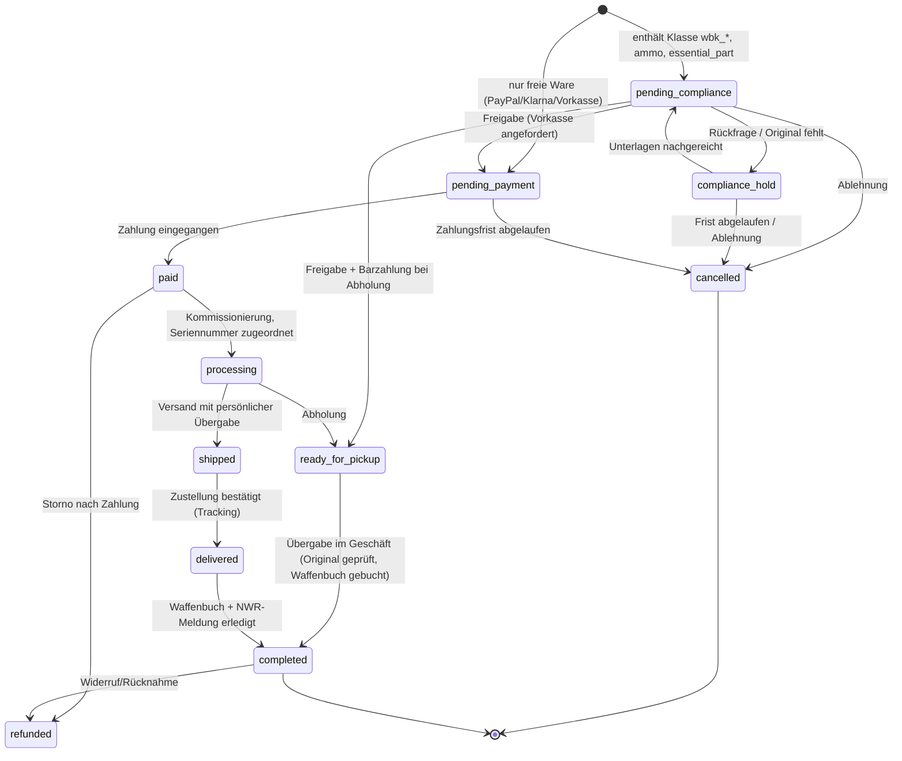

# 10 – Waffenrecht & Compliance-Konzept

Stand: 10.10.2026 · Version 1.0

> **Keine Rechtsberatung.** Dieses Dokument beschreibt, wie der Shop die waffenrechtlichen Anforderungen nach **unserem Verständnis** technisch und organisatorisch abbilden soll. Es ist Arbeitsgrundlage für die Prüfung durch einen **Fachanwalt für Waffenrecht**, die **zuständige Waffenbehörde** (nach unserer Annahme Landratsamt Esslingen, Waffenrecht – Zuständigkeit bestätigen) sowie die Zahlungs- und Versanddienstleister. Alle mit „anwaltlich zu prüfen“ markierten Punkte und die [Anwaltliche Prüfliste](#anwaltliche-prüfliste) müssen vor dem Go-live geklärt sein. Normverweise beziehen sich auf das Waffengesetz (WaffG) in der zum Zeitpunkt der Erstellung gültigen Fassung inklusive der Änderungen durch das „Sicherheitspaket“ 2024; Paragraphen und Inhalte sind vor Umsetzung gegen die aktuelle Fassung zu prüfen.

## 1. Grundprinzipien

1. **Der Händler entscheidet, nicht der Algorithmus.** Software prüft vor und blockiert offensichtliche Fälle; die Entscheidung über das Überlassen erlaubnispflichtiger Gegenstände trifft immer eine berechtigte Person (§ 34 Abs. 1 WaffG: Überlassen nur an Berechtigte, deren Berechtigung offensichtlich ist oder nachgewiesen wird).
2. **Kaufvertrag erst nach Prüfung.** Bestellungen mit erlaubnispflichtiger Ware sind rechtlich als Angebot des Kunden zu gestalten, das erst nach positiver Compliance-Prüfung angenommen wird (AGB-Gestaltung anwaltlich zu prüfen). So entsteht bei Ablehnung keine Lieferpflicht.
3. **Geld erst nach Freigabe.** Für erlaubnispflichtige Ware wird Vorkasse erst nach Compliance-Freigabe angefordert; Zahlung bei Abholung ist Standard. Das vermeidet Rückabwicklungen.
4. **Übergabe nur persönlich an die berechtigte Person** – im Geschäft oder durch einen Versanddienst, der eine persönliche Übergabe an den Berechtigten sicherstellt, oder an einen anderen Waffenhändler.
5. **Lückenlose Dokumentation:** jede Prüfung, jede Freigabe, jeder Waffenbuch-Eintrag im hash-verketteten Audit-Log.

## 2. Relevante Normen (Überblick)

| Norm | Inhalt (vereinfacht, nach unserem Verständnis) | Auswirkung im Shop |
|---|---|---|
| § 1, Anlage 1 WaffG | Begriffe: Schusswaffen, wesentliche Teile, Munition, Messer, Anscheinswaffen | Zuordnung jedes Produkts zu einer Rechtsklasse |
| **§ 2 WaffG**, Anlage 2 | Umgang mit Waffen/Munition grundsätzlich erst ab 18; Erlaubnispflicht und Verbote nach Anlage 2 (Waffenliste) | Mindestalter 18 für alle Klassen außer `free_general`; verbotene Gegenstände werden nicht angeboten |
| § 4–6 WaffG | Voraussetzungen der Erlaubnis (Zuverlässigkeit, persönliche Eignung, Sachkunde, Bedürfnis); **§ 6 Abs. 3**: unter 25 Jahren grundsätzlich Gutachten über geistige Eignung (MPU) beim erstmaligen Erwerb, mit Ausnahmen | Wird von der Behörde vor Erteilung geprüft; Shop verlässt sich auf die erteilte Erlaubnis, prüft aber Alter für Sonderfälle (Abschnitt 5) |
| **§ 10 WaffG** | Erteilung: Erwerb/Besitz über **Waffenbesitzkarte (WBK)**; Munitionserwerb über Eintrag in der WBK oder **Munitionserwerbschein** | Entitlements `wbk_voreintrag`, `ammo_permit` |
| **§ 12 WaffG** | Ausnahmen von Erlaubnispflichten (z. B. vorübergehender Erwerb, Schießstätten) | Im Onlineshop nicht genutzt; Sonderfälle nur im Laden nach Einzelfallprüfung |
| **§ 13 WaffG** | Jäger: Bedürfnis; Inhaber eines Jahresjagdscheins erwerben **Langwaffen ohne Voreintrag**, müssen den Erwerb binnen **2 Wochen** der Behörde anzeigen und die Eintragung beantragen; Kurzwaffen (grundsätzlich bis zu 2) **mit Voreintrag**; Munition für Langwaffen mit Jahresjagdschein; Schalldämpfer-Regelung für Jäger | Entitlement `hunting_license_longgun` (Langwaffen + Langwaffenmunition, ggf. Schalldämpfer – anwaltlich zu prüfen) |
| **§ 14 WaffG** | Sportschützen: Bedürfnis über Verband; Erwerb von Schusswaffen grundsätzlich ab **21** (Ausnahmen z. B. für bestimmte Einzellader-Langwaffen ab 18); **gelbe WBK** für bestimmte Waffenarten ohne Voreintrag mit Anzeige binnen 2 Wochen | Entitlement `wbk_yellow_sport`; Alterssonderregel (Abschnitt 5) |
| **§ 17 WaffG** | Waffensammler (**rote WBK**), Sammelthema | Entitlement `wbk_red_collector` nur innerhalb des eingetragenen Sammelthemas → manuelle Prüfung |
| **§ 21 WaffG** | Gewerbsmäßige Waffenherstellung, Waffenhandel (Waffenhandelserlaubnis) | Armory Falter benötigt sie; Händlerkunden müssen sie nachweisen (`dealer`) |
| **§ 23 WaffG** | **Waffenbücher**: Ein- und Ausgang erlaubnispflichtiger Schusswaffen sind zu buchen; Details AWaffV | Modul Waffenhandelsbuch, `weapon_items`, `weapon_book_entries` |
| **§ 34 WaffG** | **Überlassen** nur an Berechtigte; Prüfung der Berechtigung; Versand nur mit persönlicher Übergabe an den Berechtigten (bzw. an Händler); Anzeige-/Meldepflichten des Überlassenden (u. a. **binnen 2 Wochen**, elektronisch über das NWR für Händler) | Compliance-Freigabe, Versandregeln, NWR-Fristen-Tracking |
| **§ 35 WaffG** | Werbung, Hinweispflichten, Handelsverbote: in Angeboten erlaubnispflichtiger Waffen/Munition Hinweis auf die Erlaubnispflicht, Angabe von Name/Anschrift des Anbieters; Vertriebsverbote außerhalb fester Verkaufsstätten (u. a. Reisegewerbe) | Pflicht-Hinweis auf jeder Produktseite der Klassen `wbk_*`, `ammo`, `essential_part`; Footer-Hinweis; Prüfung der Messe-/Eventaktivitäten |
| § 36 WaffG, § 13 AWaffV | Aufbewahrung | Ratgeber-Content; Verkauf von Waffenschränken mit Widerstandsgrad-Angabe |
| **§ 42 WaffG** | Verbot des Führens bei öffentlichen Veranstaltungen; Waffen- und Messerverbotszonen (erweitert durch Sicherheitspaket 2024) | Hinweistexte bei Messern; Event-Marketing beachten |
| **§ 42a WaffG** | Führungsverbot u. a. für Anscheinswaffen, Hieb- und Stoßwaffen, Einhandmesser und feststehende Messer mit Klingenlänge über 12 cm (mit Ausnahmen für berechtigte Interessen) | Pflicht-Hinweis bei betroffenen Messern; Altersprüfung nach Rechtsklasse |
| Anlage 2 Abschnitt 1 (Verbote) | Verbotene Gegenstände, z. B. bestimmte Spring-/Fallmesser – durch Sicherheitspaket 2024 nach unserem Verständnis **verschärft** (Springmesser grundsätzlich verboten, Ausnahmen u. a. für bestimmte Berufsgruppen/Jäger) | **Messer-Sortiment vor Launch anwaltlich prüfen**; verbotene Artikel werden nicht gelistet |
| **AWaffV** | Allgemeine Waffengesetz-Verordnung: u. a. Ausgestaltung der Waffenbücher, Aufbewahrung, Sachkunde, Schießstandvorschriften | Feldumfang Waffenbuch, Aufbewahrungsfristen |
| **NWRG** | Nationales-Waffenregister-Gesetz: Registrierung von Waffen, Erlaubnissen, Händlern; elektronische Meldungen | NWR-ID je Waffe (`weapon_items.nwr_id`), Meldestatus je Waffenbuch-Ausgang |
| BGB §§ 312 ff., 355 ff. | Fernabsatz, Widerrufsrecht | Abschnitt 10 |
| PAngV § 11 | Niedrigster Gesamtpreis der letzten 30 Tage bei Preisermäßigungen | `lowest_price_30d`, Anzeige auf Produktseite |
| JuSchG / Jugendschutz | Abgabe altersbeschränkter Ware im Versand | Altersprüfung (`free_18`, Zustellung mit Alterssichtprüfung) |

## 3. Produktgruppen → Regeln

Die Tabelle ist die fachliche Vorgabe für die Seeds der `legal_classes` und für die Kategorie-Standards. Jedes Produkt wird beim Anlegen von einer Compliance-berechtigten Person einer Klasse zugeordnet; die Kategorie liefert nur einen Vorschlag.

| Produktgruppe (Beispiele) | Rechtsklasse | Mindestalter | Erwerbsnachweis | Versand | Zahlung |
|---|---|---|---|---|---|
| Bekleidung, Pflegemittel, Taschen, Gehörschutz, Zielscheiben, Optiken (Zielfernrohre, Ferngläser), Montagen, Holster | `free_general` | – | – | Standardversand | alle (PayPal, Klarna, Karte, Vorkasse, Bar, Waffen-PSP) |
| Druckluftwaffen mit F-Kennzeichnung (≤ 7,5 J), Schreckschuss-/Reizstoff-/Signalwaffen (PTB), frei erwerbbare Messer, Armbrüste, Pfefferspray (Tierabwehr), Magazine (soweit frei – anwaltlich zu prüfen) | `free_18` | 18 | Altersnachweis (geprüftes Ausweisdokument im Konto **oder** Alterssichtprüfung bei Zustellung) | Versand mit Altersprüfung 18+ (Paketdienst-Service) | Vorkasse, Bar, Waffen-PSP |
| Kurzwaffen (Pistolen, Revolver) | `wbk_shortgun` | 18 (effektiv nach Erlaubnis; Sportschützen i. d. R. 21) | WBK mit gültigem **Voreintrag** (Waffenart/Kaliber/Anzahl passend), rote WBK im Sammelthema, Händlererlaubnis, Behördenbescheinigung | Persönliche Übergabe (Abholung oder Versand mit persönlicher Zustellung) bzw. an Händler | Vorkasse nach Freigabe, Bar bei Abholung, Waffen-PSP |
| Langwaffen (Büchsen, Flinten, kombinierte Waffen, halbautomatische Langwaffen) | `wbk_longgun` | 18 (effektiv nach Erlaubnis) | Jahresjagdschein (Langwaffen, mit Hinweis Anmeldung binnen 2 Wochen), gelbe WBK (nur zulässige Waffenarten), WBK-Voreintrag, rote WBK, Händler, Behörde | wie Kurzwaffen | wie Kurzwaffen |
| Munition (Büchsen-, Kurzwaffen-, Schrotpatronen, KK) | `ammo` | 18 | Munitionserwerbsberechtigung in WBK oder Munitionserwerbschein (**kaliberbezogen**), Jahresjagdschein für Langwaffenmunition, Händler, Behörde | Versand mit persönlicher Übergabe/Altersprüfung (Dienstleister-Vorgaben beachten) oder Abholung | Vorkasse, Bar, Waffen-PSP |
| Wesentliche Teile (Läufe, Verschlüsse, Wechselsysteme), Schalldämpfer | `essential_part` | 18 | Voreintrag; Jahresjagdschein für Schalldämpfer/Wechselläufe soweit gesetzlich zugelassen (anwaltlich zu prüfen); Händler; Behörde | wie Waffen | wie Waffen |
| Pulver, Zündhütchen (Wiederladen), Großkaliber-Gebrauchtwaffen mit Sonderstatus, Einzelstücke mit unklarer Rechtslage, Sprengstoffrechtlich relevante Waren | `pickup_only` | 18 | Prüfung im Geschäft (z. B. Erlaubnis nach SprengG § 27 für Treibladungspulver – anwaltlich zu prüfen) | **nur Abholung** | Vorkasse, Bar |
| Verbotene Gegenstände (Anlage 2 Abschnitt 1) | – | – | – | **nicht im Sortiment** | – |

Behördenartikel (`usage_defense_authority`) sind nur für verifizierte Behördenkonten sichtbar; Abgabe nur gegen Behördenbescheinigung/Beschaffungsauftrag.

## 4. Erlaubnisdokumente und ihre Abbildung

| Dokument | Was es nach unserem Verständnis erlaubt | Abbildung als Entitlement | Prüfpunkte |
|---|---|---|---|
| **WBK grün** (§ 10) | Besitz der eingetragenen Waffen; **Erwerb nur mit Voreintrag** (Erwerbsberechtigung für eine bestimmte Waffenart/Kaliber, befristet – i. d. R. 1 Jahr); Munitionserwerb, soweit für die eingetragene Waffe eingetragen | je Voreintrag `wbk_voreintrag` (weapon_kind, caliber, quantity = 1, valid_until); je Munitionsberechtigung `ammo_permit` (caliber) | Name/Geburtsdatum, ausstellende Behörde, Nummer, Voreintrag (Seite mit Stempel), Gültigkeit des Voreintrags, bereits verbraucht? |
| **WBK gelb** (§ 14 Abs. 6, Sportschützen) | Erwerb **ohne Voreintrag** von bestimmten Waffenarten (nach unserem Verständnis: Einzellader-Langwaffen mit glatten und gezogenen Läufen, Repetier-Langwaffen mit gezogenen Läufen, einläufige Einzellader-Kurzwaffen für Patronenmunition, mehrschüssige Kurz- und Langwaffen mit Zündhütchenzündung (Perkussion)); Anzahlbegrenzung (10 Waffen); Anzeige binnen 2 Wochen | `wbk_yellow_sport` (weapon_kind `any`, Einschränkung über Produktattribut „gelbe-WBK-fähig“) | Waffenart des Produkts (Einzellader/Repetierer, Halbautomaten **nicht**), Anzahl eingetragener Waffen (Kundenerklärung), Gültigkeit |
| **WBK rot** (§ 17, Sammler) | Erwerb im Rahmen des eingetragenen **Sammelthemas** | `wbk_red_collector` | Sammelthema wörtlich gegen Produkt prüfen → immer manuelle Einzelfallentscheidung |
| **Jahresjagdschein** (§ 13) | Erwerb von **Langwaffen ohne Voreintrag** (Anzeige an die Behörde binnen 2 Wochen und Antrag auf Eintragung in die WBK durch den Käufer); **Kurzwaffen nur mit Voreintrag** (grundsätzlich bis zu 2); **Munition für Langwaffen**; Schalldämpfer für Langwaffen nach den Sonderregeln für Jäger | `hunting_license_longgun` (valid_until = Ende der Jagdschein-Gültigkeit, i. d. R. 31.03.); für Kurzwaffenmunition zusätzlich `hunting_license_shortgun_ammo` bzw. `ammo_permit` nur bei eingetragener Kurzwaffe/Munitionsberechtigung | Jahresjagdschein (nicht Tagesjagdschein/Ausländerjagdschein ohne Prüfung), Gültigkeitszeitraum, Name; Hinweis an Kunden zur 2-Wochen-Anzeige |
| **Munitionserwerbschein** (§ 10 Abs. 3) | Erwerb bestimmter Munition (kaliberbezogen) | `ammo_permit` (caliber) | Kaliber, Gültigkeit |
| **Waffenhandelserlaubnis** (§ 21) | Erwerb durch Händler | `dealer` | Erlaubnisbescheid, Firmenname = Kundenkonto, Gültigkeit |
| **Behördenbescheinigung** | Beschaffung durch Behörden | `authority` | Dienststelle, Beschaffungsauftrag, Ansprechpartner |
| **Personalausweis/Reisepass** | Identität + Alter | kein Entitlement; setzt `age_verified_at` | Abgleich Name/Geburtsdatum; Datei-Löschung nach 30 Tagen |

Hinweis zur Datenminimierung: Bei Ausweisen bitten wir, nicht benötigte Felder (z. B. Zugangsnummer/CAN, Foto bei reiner Altersprüfung) zu schwärzen; Kopien von Ausweisen sind nach PAuswG nur unter bestimmten Bedingungen zulässig (als Kopie erkennbar, Einwilligung) – anwaltlich zu prüfen.

## 5. Altersregeln im Checkout

| Fall | Regel im `ComplianceGate` |
|---|---|
| Alle Klassen außer `free_general` | Geburtsdatum Pflicht; Alter ≥ `min_age` (18) zum Bestellzeitpunkt |
| `free_18` | Zusätzlich: verifiziertes Alter **oder** Versandart mit Alterssichtprüfung 18+ |
| Kurzwaffe/Langwaffe auf Basis **gelber WBK** und großkalibrige Waffen für Sportschützen | Warnung/Hold, wenn Kunde < 21: § 14 Abs. 1 sieht nach unserem Verständnis für Sportschützen grundsätzlich 21 Jahre vor (Ausnahmen für bestimmte Einzellader-Langwaffen ab 18) → manuelle Prüfung, Kaliber-Flag `calibers.is_large_bore` |
| Kunde < 25 | Hinweis im Compliance-Detail: Erstausstellung der Erlaubnis setzte ggf. MPU voraus (§ 6 Abs. 3); die Behörde hat dies geprüft – **kein eigener Blocker**, aber Plausibilitätsprüfung der Erlaubnis (Ausstellungsdatum) |
| Jäger < 18 (Jugendjagdschein) | Kein Erwerb von Waffen/Munition über den Shop |

Die effektive Berechtigung ergibt sich aus der behördlichen Erlaubnis; der Shop prüft Alter zusätzlich, ersetzt aber keine behördliche Entscheidung.

## 6. Workflow Dokumentenprüfung

```
Kunde lädt Dokument hoch
   │  (PDF/JPG/PNG, ≤ 10 MB, Angabe Typ, Nummer, gültig bis)
   ▼
[uploaded] ──Job DocumentPrecheck──► [precheck_passed] oder [precheck_flagged]
   (Format, Größe, Lesbarkeit, Ablaufdatum, Namensabgleich, Dublette)
   ▼
Compliance-Mitarbeiter öffnet Prüfansicht (Side-by-Side)
   ├─ Checkliste abhaken (Typ, Name/Geb.-Datum, Gültigkeit, Echtheitsmerkmale plausibel)
   ├─ Felder korrigieren (Nummer, Gültigkeit, Behörde)
   ├─ Entitlements anlegen (je Voreintrag/Berechtigung eine Zeile)
   ▼
[approved] ──► Kunde informiert, offene Bestellungen neu bewertet
[rejected] ──► Kunde informiert (Grund), Datei-Löschfrist 90 Tage
Rückfrage  ──► Status bleibt, Nachricht an Kunden
   ▼
Ablauf: Job entitlements:expire → [expired], Erinnerung 30 Tage vorher
Widerruf (z. B. Hinweis der Behörde, Zweifel) → [revoked] + alle offenen Bestellungen → compliance_hold
```

Wichtig: Die Online-Prüfung einer Kopie ersetzt nach unserem Verständnis **nicht** die Prüfung des Originals vor dem Überlassen. Vorgesehen ist: Vorlage des Originals bei Abholung; beim Versand Zusendung des Originals bzw. einer amtlich beglaubigten Kopie oder ein anderes von Anwalt/Behörde bestätigtes Verfahren (anwaltlich zu prüfen).

## 7. Workflow Bestellung (State Machine)



Regeln:

- `compliance_status` läuft parallel: `not_required` | `pending` | `approved` | `rejected`.
- Bei **gemischten Warenkörben** (z. B. Zubehör + Waffe) wird empfohlen, die Bestellung zu teilen, damit freie Ware sofort ausgeliefert und mit PayPal/Klarna bezahlt werden kann (Checkout bietet „Zubehör separat bestellen“ an).
- Reservierung des Bestands bei `pending_compliance` (Standard 14 Tage, verlängerbar).
- Freigabe erfordert: alle Positionen `passed` (automatisch) + manuelle Bestätigung + Originaldokument-Status (bei Abholung: Prüfung am Tresen, Checkbox im Admin beim Abschluss).
- Bei Übergabe/Versand einer seriennummernpflichtigen Waffe: Zuordnung `weapon_item`, Waffenbuch-Ausgang, Aufgabe „NWR-Meldung“ mit Frist.

## 8. Versandregeln

| Versandart (`shipping_methods.code`) | Bedient `shipping_mode` | Beschreibung | Klärung |
|---|---|---|---|
| `dhl_standard` | standard | DHL Paket | – |
| `dhl_age_check` | age_check | DHL Paket mit **Alterssichtprüfung 18+** | Vertrag DHL |
| `weapon_personal` | weapon_personal | Versand mit **persönlicher Übergabe an den Erwerber** (z. B. DHL „Eigenhändig“ + „Ident-Check“ bzw. spezialisierter Waffen-/Werttransportdienst) | Ob und zu welchen Bedingungen der Dienstleister Waffen/Munition befördert, ist **vertraglich** zu klären – Standard-Beförderungsbedingungen schließen Waffen/Munition häufig aus |
| `dealer_transfer` | weapon_personal | Versand an einen anderen Waffenhändler zur Übergabe dort | Erlaubnis des Empfangshändlers prüfen |
| `pickup` | alle | Abholung im Geschäft Wolfschlugen | Ausweis + Original-Erlaubnis vorlegen |

Zusätzliche Regeln: Lieferadresse = Meldeadresse laut Erlaubnis (keine Packstationen, keine Abweichung bei Waffen/Munition); kein Auslandsversand von Waffen/Munition (Export/Verbringung erfordert gesonderte Erlaubnisse – außerhalb des Shop-Umfangs); Verpackung neutral ohne Hinweise auf Inhalt; Munition getrennt von Waffen verpacken, Gefahrgutvorschriften (ADR, Munition i. d. R. Klasse 1.4S) beachten; Versicherung/Wertdeklaration.

## 9. Zahlungsregeln

| Zahlart | Zulässig für Klassen | Hinweis |
|---|---|---|
| PayPal | `free_general` | PayPal-AUP schließt Waffen, Munition und bestimmte Teile/Zubehör aus; Liste mit PayPal schriftlich abstimmen |
| Klarna (inkl. Sofort/Pay by Bank) | `free_general` | Klarna-Richtlinien schließen Waffen/Munition aus; Abstimmung |
| Kreditkarte (Acquirer/PSP) | `free_general` bzw. laut Vertrag | Viele PSPs (z. B. Stripe, Mollie) schließen Waffen/Munition aus |
| Waffenfreundlicher PSP | alle laut Vertrag | Anbieter mit ausdrücklicher Freigabe für den Waffenhandel suchen und vertraglich fixieren |
| Vorkasse (Überweisung) | alle | Bei erlaubnispflichtiger Ware erst **nach** Compliance-Freigabe anfordern |
| Barzahlung bei Abholung | alle | Geldwäsche: Bargeschäfte ≥ 10 000 € → Identifizierungs- und Aufzeichnungspflichten nach GwG für Güterhändler (Schwellenwerte anwaltlich bestätigen) |
| Kauf auf Rechnung | `dealer`, `authority` | Nach Freigabe des Kundenkontos |

Die Zahlartenliste im Checkout ist die **Schnittmenge** der `allowed_payment_codes` aller Positionen; serverseitig erzwungen (Manipulationstest im Testkatalog).

## 10. Fernabsatz, Widerruf, AGB

- Nach unserem Verständnis besteht beim Fernabsatzkauf von Waffen/Munition grundsätzlich ein **Widerrufsrecht** (keine allgemeine Ausnahme in § 312g BGB). Die Rücksendung muss waffenrechtlich zulässig erfolgen (Rückgabe im Geschäft oder Versand mit persönlicher Übergabe an den Händler); Kostenregelung und Wertersatz (z. B. bei Schussabgabe) in der Widerrufsbelehrung – **anwaltlich zu prüfen**.
- Munition: Prüfen, ob Ausnahmen (z. B. versiegelte Ware) greifen – anwaltlich.
- Bei Widerruf: Waffenbuch-Eingang (Rücknahme), ggf. NWR-Meldung.
- AGB: Vertragsschluss erst mit Freigabe (siehe 1.2), Pflichten des Kunden (wahre Angaben, Vorlage des Originals, Anzeige an die Behörde binnen 2 Wochen bei Jagdschein/gelber WBK), Recht des Händlers, ohne Angabe von Gründen nicht zu überlassen (Zuverlässigkeitszweifel), Reservierungsfristen.
- Pflichtangaben auf Produktseiten: Gesamtpreis inkl. MwSt., Versandkosten, Lieferzeit, wesentliche Eigenschaften, **Hinweis auf Erlaubnispflicht** (§ 35 WaffG) und Anbieterangaben.
- Button „Zahlungspflichtig bestellen“, Bestellbestätigung als Eingangsbestätigung (nicht Annahme) bei erlaubnispflichtiger Ware.

## 11. Waffenhandelsbuch (§ 23 WaffG, AWaffV)

- Jede erlaubnispflichtige Schusswaffe (und nach Vorgabe wesentliche Teile/Schalldämpfer) erhält beim Wareneingang einen `weapon_item` mit verschlüsselter Seriennummer und einen **Eingangseintrag** (Lieferant/Verkäufer mit Erlaubnisdaten, Datum).
- Beim Überlassen: **Ausgangseintrag** mit Erwerber (Name, Anschrift, Erlaubnis-Art/-Nummer, ausstellende Behörde), Datum, Bestellung.
- Einträge sind unveränderlich; Korrekturen nur als Gegenbuchung mit Begründung; Audit-Log.
- Export (PDF/CSV) für Behördenprüfungen; Aufbewahrung nach AWaffV (Planwert: mindestens 10 Jahre nach letzter Eintragung, Übergabe an die Behörde bei Geschäftsaufgabe – anwaltlich zu bestätigen).
- **Offene Frage:** Seit den Änderungen durch das 3. Waffenrechtsänderungsgesetz sind Waffenbücher nach unserem Verständnis **elektronisch** zu führen und Händler-Meldungen elektronisch an das NWR zu übermitteln. Ob das Shop-Modul als führendes Waffenbuch genügt oder eine zugelassene Fachsoftware mit NWR-Schnittstelle (XWaffe) eingesetzt wird und der Shop nur exportiert/abgleicht, ist mit der Behörde zu klären. Bis dahin: Shop-Modul als **Neben-/Vorerfassung**, führendes Waffenbuch in der bestehenden Lösung des Händlers.

## 12. NWR-Meldungen

- Erwerb/Überlassen erlaubnispflichtiger Waffen ist nach unserem Verständnis innerhalb von **2 Wochen** (§ 34 Abs. 2 WaffG i. V. m. NWRG) der zuständigen Behörde elektronisch anzuzeigen.
- Umsetzung Phase 1: Aufgabe je Ausgangsbuchung mit Frist, Dashboard-Warnung ab Tag 10, Feld `nwr_reported_at` + `nwr_reference`; Meldung erfolgt manuell bzw. über die Händlersoftware/das Behördenportal.
- Phase 2 (nach Klärung): Anbindung über die von der Behörde vorgegebene Schnittstelle.
- Kunden mit Jagdschein/gelber WBK werden in Bestätigungs-E-Mail und Abholprotokoll auf **ihre eigene** Anzeigepflicht (binnen 2 Wochen) hingewiesen.

## 13. Aufbewahrung und Löschung von Nachweisen

| Datum | Zweck | Planwert Speicherdauer | Rechtsgrundlage (anwaltlich/DSB zu bestätigen) |
|---|---|---|---|
| Ausweiskopie (Altersprüfung) | Altersnachweis | Löschung 30 Tage nach Prüfung; gespeichert bleibt nur „verifiziert am/Methode/geprüft von“ | Art. 6 Abs. 1 lit. c/b DSGVO, PAuswG |
| WBK/Jagdschein ohne Geschäft | Vorabprüfung | bis Ablauf der Berechtigung bzw. Widerruf durch Kunden, max. 3 Jahre | Art. 6 Abs. 1 lit. b DSGVO |
| WBK/Jagdschein zu durchgeführtem Waffengeschäft | Nachweis der Berechtigungsprüfung | entsprechend Dokumentationspflicht (Planwert 10 Jahre) | Art. 6 Abs. 1 lit. c DSGVO i. V. m. WaffG/AWaffV |
| Abgelehnte Dokumente | Nachvollziehbarkeit | 90 Tage | berechtigtes Interesse |
| Waffenbuch | Gesetzliche Pflicht | nach AWaffV | Art. 6 Abs. 1 lit. c |

Speicherung verschlüsselt auf privater Disk außerhalb des Webroots, Zugriff nur Compliance, jeder Zugriff protokolliert. Details in [13-sicherheit.md](13-sicherheit.md).

## 14. Werbung & Kommunikation

- Jede Werbung (Newsletter, Social, Blog mit Produktbezug) für erlaubnispflichtige Waffen/Munition enthält den Hinweis auf die Erlaubnispflicht und Anbieterangaben (§ 35 WaffG).
- Plattformrichtlinien (Google, Meta, YouTube, TikTok) beschränken Waffen-/Munitionswerbung erheblich → siehe [15-marketing.md](15-marketing.md).
- Keine Verharmlosung, keine Ansprache Minderjähriger, keine Aussagen zu Selbstverteidigung mit erlaubnispflichtigen Waffen.
- Messen/Events: Verkaufsverbote außerhalb fester Verkaufsstätten beachten (§ 35 Abs. 3 WaffG) – auf Messen nur Präsentation/Beratung, Abschluss im Geschäft bzw. nach Rechtslage.

## 15. Organisatorische Maßnahmen

- Benannte verantwortliche Person(en) für Compliance (mit Fachkunde), Vertretungsregel.
- Schulung aller Mitarbeiter (Erkennen von Erlaubnisarten, Fälschungsmerkmale, Abholprozess) vor Launch, jährlich wiederholt.
- Abholprotokoll (digital im Admin): Identität geprüft, Original-Erlaubnis geprüft, Seriennummer übergeben, Belehrung zur Anzeigepflicht, Unterschrift (Tablet) – Notwendigkeit/Formular anwaltlich prüfen.
- Verdachtsfälle (z. B. auffällige Mehrfachbestellungen, gefälschte Dokumente): Bestellung anhalten, Geschäftsführung informieren, ggf. Behörde/Polizei; Sperrvermerk.
- Jährliche interne Prüfung: Stichprobe 20 Waffengeschäfte (Dokumente, Waffenbuch, NWR-Meldung, Audit-Log).

## Anwaltliche Prüfliste

Folgende Punkte sind vor dem Go-live durch einen **Fachanwalt für Waffenrecht** (FA), die **zuständige Waffenbehörde** (BH), den **Datenschutzbeauftragten** (DSB), **Steuerberater** (StB) bzw. die **Zahlungs-/Versanddienstleister** (DL) schriftlich zu klären. Status wird im Projekt-Tracker gepflegt.

| Nr. | Prüfpunkt | Wer | Bezug |
|---|---|---|---|
| 1 | Ist die Zuordnung aller Produktgruppen zu Rechtsklassen (Tabelle Abschnitt 3) korrekt – insbesondere Magazine, Wechselsysteme, Schalldämpfer, Armbrüste, Druckluft-/SRS-Waffen, Wiederladekomponenten, Behördenartikel? | FA | §§ 1, 2, Anlagen 1/2 WaffG |
| 2 | Messer-Sortiment: Welche Messer sind nach dem Sicherheitspaket 2024 verboten (Springmesser, Fallmesser u. a.), welche unterliegen Führungsverboten (§ 42a) und welche Hinweise/Altersgrenzen sind im Shop nötig? | FA | § 42, § 42a, Anlage 2 WaffG |
| 3 | Genügt die Online-Prüfung einer Kopie für die Bestellannahme, und wie ist vor dem Überlassen die Berechtigung nachzuweisen (Original bei Abholung; beim Versand: Originalzusendung, beglaubigte Kopie, anderes Verfahren)? | FA, BH | § 34 Abs. 1 WaffG |
| 4 | Versand erlaubnispflichtiger Waffen, wesentlicher Teile und Munition: Welche Versandart erfüllt die Anforderung der persönlichen Übergabe? Ist DHL „Eigenhändig“/Ident-Check ausreichend? Darf Munition mit Alterssichtprüfung versendet werden oder ist ebenfalls persönliche Übergabe nötig? | FA, DL | § 34 WaffG, Beförderungsbedingungen, ADR |
| 5 | Vertragsgestaltung: Vertragsschluss erst nach Compliance-Freigabe; AGB-Klauseln zu Ablehnung, Reservierung, Vorkasse nach Freigabe | FA | BGB, AGB-Recht |
| 6 | Widerrufsbelehrung für Waffen/Munition/wesentliche Teile; Rücksendeweg; Wertersatz nach Benutzung; Ausnahmen für Munition | FA | §§ 312g, 355 ff. BGB |
| 7 | Altersgrenzen je Klasse und Sonderfälle: 21 Jahre für Sportschützen (§ 14 Abs. 1), Behandlung von unter 25-Jährigen (§ 6 Abs. 3), Jugendjagdschein | FA | §§ 2, 6, 13, 14 WaffG |
| 8 | Umfang gelbe WBK: Welche Produkte dürfen auf gelbe WBK ohne Voreintrag verkauft werden (Kennzeichnung im Katalog), Nachweis der Anzahlgrenze? | FA, BH | § 14 Abs. 6 WaffG |
| 9 | Jahresjagdschein: Umfang (Langwaffen, Langwaffenmunition, Schalldämpfer, Wechselläufe), Behandlung von Ausländerjagdschein/Tagesjagdschein; Hinweis zur 2-Wochen-Anzeige | FA | § 13 WaffG |
| 10 | Munitionserwerb: Nachweis kaliberbezogener Erwerbsberechtigung (grüne/gelbe WBK, Munitionserwerbschein); Mengenbegrenzungen | FA | § 10 Abs. 3 WaffG |
| 11 | Rote WBK (Sammler): Prüfverfahren für das Sammelthema | FA, BH | § 17 WaffG |
| 12 | Elektronisches Waffenhandelsbuch: Muss es in einer zugelassenen Software geführt werden? Reicht das Shop-Modul? Pflichtfelder, Aufbewahrungsfrist, Exportformat | BH, FA | § 23 WaffG, AWaffV |
| 13 | NWR-Meldungen: Verfahren, Schnittstelle (XWaffe/Portal), Fristen, Zuständigkeit Händler vs. Kunde | BH | § 34 Abs. 2 WaffG, NWRG |
| 14 | Werbehinweise nach § 35 WaffG: Formulierung auf Produktseiten, Newsletter, Social Media; zulässige Aktivitäten auf Messen/Events | FA | § 35 WaffG |
| 15 | Treibladungspulver/Zündhütchen: sprengstoffrechtliche Anforderungen an Verkauf, Lagerung, Abgabe (nur Abholung?) | FA, BH (Gewerbeaufsicht) | SprengG, 1. SprengV |
| 16 | Behördenartikel und Verkauf an Sicherheitsunternehmen: Nachweise, Bewachungserlaubnis, Waffenschein | FA | §§ 28 ff. WaffG |
| 17 | Ausweiskopien: Zulässigkeit der Speicherung, Schwärzungshinweise, Löschfristen | DSB, FA | PAuswG, DSGVO |
| 18 | DSFA für Verarbeitung von Ausweis-/WBK-Kopien und Berechtigungsdaten; Rechtsgrundlagen; Löschkonzept | DSB | Art. 35 DSGVO |
| 19 | Aufbewahrungsfristen für Nachweise zu Waffengeschäften (Planwert 10 Jahre) | FA, DSB | WaffG/AWaffV, DSGVO |
| 20 | Zahlungsanbieter: schriftliche Bestätigung, welche Warengruppen erlaubt sind (PayPal, Klarna, Kartenakzeptanz); Auswahl eines waffenfreundlichen PSP | DL | AUP der Anbieter |
| 21 | Geldwäsche: Pflichten bei Barzahlung als Güterhändler (Schwellenwerte, Identifizierung, Aufzeichnung) | FA, StB | GwG |
| 22 | Versanddienstleister: schriftliche Vereinbarung über Beförderung von Waffen/Munition, Gefahrgut (Munition), Versicherung | DL | Beförderungsbedingungen, ADR |
| 23 | Hoster und Cloudflare: AGB erlauben Betrieb eines Shops für Waffen/Munition? AV-Verträge | DL, DSB | AGB, Art. 28 DSGVO |
| 24 | Verkaufsservice (egun-Kommission) und Ankauf: Vertragsmuster, Eigentum/Besitz während Kommission, Waffenbuch-Behandlung, Abwicklung über egun-AGB | FA | §§ 23, 34 WaffG, egun-AGB |
| 25 | Ankauf aus Nachlass/Erbe: Prüfung der Berechtigung des Verkäufers (Erben-WBK, Blockiersystem), Hinweistexte | FA, BH | § 20 WaffG |
| 26 | Werkstatt: Annahme von Kundenwaffen (Aufbewahrung, Dokumentation, Überlassen zur Reparatur), Cerakote/Arbeiten an wesentlichen Teilen | FA, BH | §§ 12, 21, 23 WaffG |
| 27 | Abholprotokoll und Belehrungen: notwendige Inhalte, Unterschrift | FA | § 34 WaffG |
| 28 | Preisangaben: 30-Tage-Tiefstpreis, Grundpreisangabe bei Munition (€/Stück), Gebrauchtware | FA | PAngV |
| 29 | Barrierefreiheit (BFSG): Anwendbarkeit (Kleinstunternehmen-Ausnahme?) und Inhalt der Erklärung | FA | BFSG |
| 30 | E-Rechnung für B2B-Kunden (Empfangspflicht seit 2025, Ausstellungspflicht nach Übergangsfristen) | StB | UStG § 14 |

> Ergebnis jedes Prüfpunkts (Datum, Prüfer, Entscheidung, ggf. Anpassung von `legal_classes`, Texten oder Prozessen) wird dokumentiert; Änderungen an Rechtsklassen sind Admin-Datenänderungen, keine Codeänderungen.
